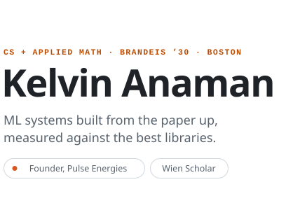
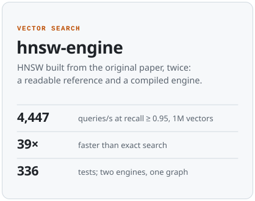
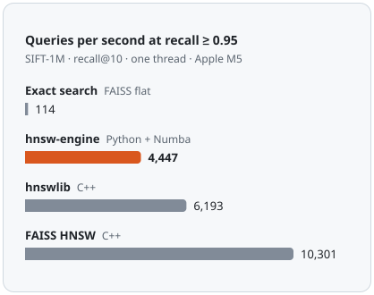
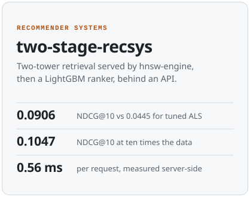
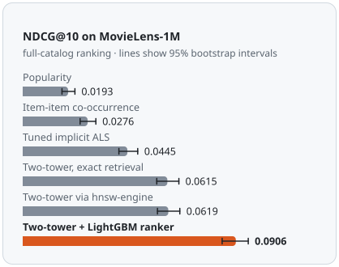

  <picture><source media="(prefers-color-scheme: dark)" srcset="assets/name-dark.svg"></picture>
  <picture><source media="(prefers-color-scheme: dark)" srcset="assets/graph-dark.svg"></picture>

The graph is real: an index of 40 points built by <a href="https://github.com/anamankev/hnsw-engine">hnsw-engine</a>, and one search through it, from the entry point down to the nearest neighbour.

I study computer science and applied mathematics at Brandeis (Wien Scholar, class of 2030) and I'm the founder of [Pulse Energies](https://pulseenergies.com), where we build software for electricity grids.

On GitHub I rebuild the systems I want to understand. I start from the paper, test hard, benchmark against the libraries everyone already trusts, and write down every gap, including the ones that don't flatter me.

[LinkedIn](https://www.linkedin.com/in/kelvin-anaman) · [Email](mailto:kanaman@brandeis.edu) · [Pulse Energies](https://pulseenergies.com)

## Selected work

  <a href="https://github.com/anamankev/hnsw-engine"><picture><source media="(prefers-color-scheme: dark)" srcset="assets/hnsw-engine-facts-dark.svg"></picture></a>
  <a href="https://github.com/anamankev/hnsw-engine"><picture><source media="(prefers-color-scheme: dark)" srcset="assets/hnsw-engine-chart-dark.svg"></picture></a>

**[hnsw-engine](https://github.com/anamankev/hnsw-engine)** is HNSW approximate nearest-neighbour search, implemented from the original paper twice: a readable Python reference, and a compiled Numba engine proven to build the bit-identical graph. It is benchmarked against FAISS and hnswlib with one single-threaded method, and it matches FAISS's recall within 0.01 on three datasets. It also has filtered search, int8 quantization and memory-mapped index files.
[Benchmarks](https://github.com/anamankev/hnsw-engine/blob/main/docs/BENCHMARKS.md) · [Performance notes](https://github.com/anamankev/hnsw-engine/blob/main/docs/PERFORMANCE.md) · [Studies](https://github.com/anamankev/hnsw-engine/blob/main/docs/STUDIES.md)

  <a href="https://github.com/anamankev/two-stage-recsys"><picture><source media="(prefers-color-scheme: dark)" srcset="assets/two-stage-recsys-facts-dark.svg"></picture></a>
  <a href="https://github.com/anamankev/two-stage-recsys"><picture><source media="(prefers-color-scheme: dark)" srcset="assets/two-stage-recsys-chart-dark.svg"></picture></a>

**[two-stage-recsys](https://github.com/anamankev/two-stage-recsys)** is a movie recommender built the way large production systems are: a PyTorch two-tower model retrieves 200 candidates through hnsw-engine, a LightGBM LambdaRank model reorders them, and a FastAPI service returns the top ten. It is evaluated with full-catalog ranking, a leakage-tested temporal split and 95% bootstrap intervals. The first ranker scored below plain retrieval, and the write-up shows how that was diagnosed and fixed.
[Results](https://github.com/anamankev/two-stage-recsys/blob/main/docs/RESULTS.md) · [Analysis](https://github.com/anamankev/two-stage-recsys/blob/main/docs/ANALYSIS.md) · [Model card](https://github.com/anamankev/two-stage-recsys/blob/main/docs/MODEL_CARD.md)

## Research and experience

- **[Pulse Energies](https://pulseenergies.com)**, founder and CEO, 2025 to now. Physics-constrained AI for forecasting and orchestrating electricity grids.
- **SmartPyro**, research. [*AI-Optimized Pyrolysis: A Machine Learning Framework for Predictive Waste-to-Energy Conversion*](https://sciforum.net/paper/view/30748), with Sanjith Balamurali, at the 3rd International Online Conference on Energies (IOCEN 2026). Also presented at ASME ES2026.
- **Lumiere Research Program**, machine learning researcher, 2025. A PyTorch classifier for vector boson polarization in simulated Large Hadron Collider events, supervised by Dr. Gaetano Barone of Brown University.
- **Hubtel**, technical product manager intern, 2026, on merchant payments. **IPMC Ghana**, software engineer intern, 2025, on an observability dashboard built with GraphQL and React.
- **Awards.** IFoRE Medalist, first award in physics and engineering interdisciplinary research. SSRN Emerging Scholar Award.

## Toolbox

`Python` `NumPy` `Numba` `PyTorch` `LightGBM` `FastAPI` `Docker` `pytest` `Java` `SQL`

  <picture><source media="(prefers-color-scheme: dark)" srcset="assets/footer-dark.svg"></picture>

